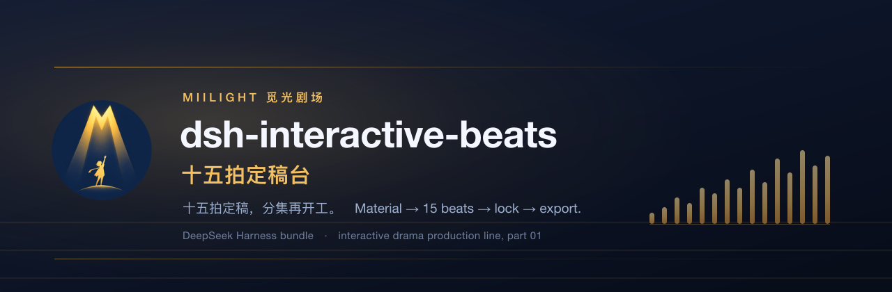
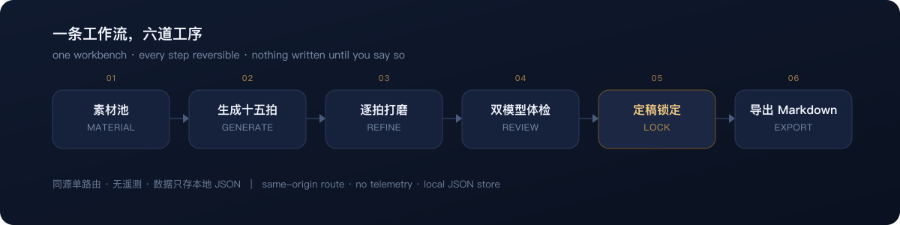
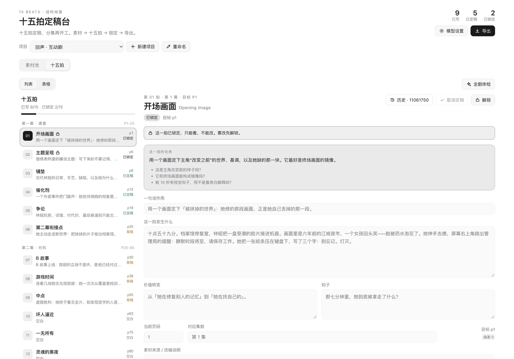

<p align="center">
  
</p>

<p align="center">
  <a href="https://github.com/MiiLight0/dsh-interactive-beats/releases"></a>
  <a href="https://github.com/deepseek-ai/deepseek-harness"></a>
  <a href="./LICENSE"></a>
  
  <a href="./README.zh-CN.md"></a>
</p>

# dsh-interactive-beats · 十五拍定稿台

**A DeepSeek Harness bundle that turns a pile of story material into a locked 15-beat
foundation your episodes are written against.**

This bundle is the piece of our own production pipeline that colleagues kept asking to borrow.
It runs every day, so it is open source now.

It is a **workbench, not an autopilot**. The model writes a first draft, you decide what stays.
Every model rewrite is shown as a per-cell comparison before it lands, every beat keeps its own
version history, and the finished foundation gets frozen so the drafting stage stops drifting.

<p align="center">
  
</p>

---

## Why another beat sheet

Interactive drama multiplies the work. One branch becomes eight, the eight need endings, and
the endings need to pay off beats planted forty episodes earlier. What breaks first is never
the writing — it is the **structure**: everyone remembers a slightly different version of what the
story is about, and by episode 30 the branch tree has outgrown the premise.

Three things we wanted and could not find in one place:

1. **A single messy inbox.** World, characters, synopsis, half-ideas from a group chat — dumped
   in one document, unsorted, on purpose.
2. **A model that is allowed to cut.** Most structure prompts try to preserve everything you
   pasted. This one is explicitly told to merge, move and delete so 15 beats come out, not 15
   summaries.
3. **A structure you can trust tomorrow.** Per-beat versions, cell-level comparisons, a lock, and a
   Markdown export that a human writer can actually read.

## What it does

| Stage | What you get |
| --- | --- |
| **Material pool** | One working document per project: world, characters, synopsis, loose ideas. Deliberately messy. |
| **Generate 15 beats** | One throughline from the whole pile: logline, theme, 15 beats, missing-material list, structure notes. |
| **Refine** | List view or table view. Page, one-liner, content and hook are editable in place and save on blur. |
| **Batch rewrite** | Select up to 6 beats, write one instruction, preview proposals, then accept per cell or all at once. |
| **Review** | One score, five weighted dimensions, concrete issues, one fix, three alternatives. Dual-model mode runs the same prompt on two models and shows both cards side by side. |
| **Lock** | Finalize, then lock. Locked beats are read-only. Locking all 15 freezes the foundation. |
| **Export** | Markdown with the brief, all 15 beats, reviews, notes, missing material and structure notes. Copy or download. |

This is the workbench with a project open:

<p align="center">
  
</p>

Version ids are `MMDDHHMM`, not `V1`/`V2` — two versions inside the same minute get bumped by a
minute so they stay distinguishable. Star a version to mark it as a known-good rollback point,
and filter the history to starred entries only.

## Requirements

- DeepSeek Harness **0.2.x** (`engines.dsh` is `>=0.2.0 <0.3.0`).
- A **web** profile. The panel is a client module (`dsh.client.platform: "web"`); TUI and
  headless profiles only get the HTTP half.
- Node.js **20 or newer**.
- At least one model available to DSH — the panel reads the model list from the Host, so no API
  key is needed for models DSH already knows about.

## Install

Pick one. Every command targets a profile; `web` is the usual one.

```sh
# GitHub, tracking the default branch
dsh plugin --profile web add github:MiiLight0/dsh-interactive-beats

# GitHub, pinned to a release (recommended for anything you rely on)
dsh plugin --profile web add github:MiiLight0/dsh-interactive-beats#v0.2.0

# A packed tarball, no registry and no build permission needed
dsh plugin --profile web add ./dsh-interactive-beats-0.2.0.tgz

# npm, once published
dsh plugin --profile web add dsh-interactive-beats
```

This package is plain JavaScript and ships no build step, so pnpm's `allowBuilds` approval is
**not** required for any of the installs above.

Then:

1. Restart the profile so the Host half loads.
2. Refresh the Harness page once — the client half is picked up on page load.
3. Look for **十五拍定稿台** in the left sidebar (`sidebar.panellist`) and the main panel.

Verify the bundle became a profile layer and not just a dependency:

```sh
dsh --profile web --dump-config | grep interactive-beats
```

On PowerShell, that is `| Select-String interactive-beats`.

A healthy install shows the row `interactive-beats` pointing at `dsh-interactive-beats`. If the
package installs but no row appears, the profile prints
`declares no dsh.bundle — installed as a plain dependency, not a profile layer`.

Uninstall:

```sh
dsh plugin --profile web remove dsh-interactive-beats
```

Project data stays in the profile's `plugin-data` directory (see [Data & privacy](#data--privacy));
delete it by hand if you want a clean slate.

## First run

1. **新建项目** — name the project. The bundle ships empty; there is no sample story.
2. **素材池** — paste everything you have. More mess is fine; the generation prompt is built to
   cut, merge and reorder rather than to preserve.
3. **生成 15 拍** — takes 30–90 seconds on a normal model. The result replaces all 15 beats, so
   the panel asks first if any beat already has text.
4. **对比生成** — optional. Runs the same material and prompt through the primary and secondary
   routes in parallel and shows two full sheets. Nothing is written until you press 采用这一版.
5. **十五拍** — switch between list and table, edit, and use 体检这一拍 when a beat feels wrong.
6. **批量改写** — select beats, one instruction, preview the diff, apply per cell.
7. **定稿 → 锁定** — lock what you trust. Locked beats reject edits, and generation refuses to run
   while anything is still locked.
8. **导出** — Markdown, ready for a writer or your own episode tooling.

The panel follows the Harness language and ships complete Chinese and English dictionaries. The copy
was written in Chinese first, because that is the language our writers and directors work in; the
English version is a full translation, not a fallback. The eight steps above use the Chinese labels
you will see in the screenshots.

## Models

The settings panel asks the Host what models exist (`llm.listProviders()` / `llm.listModels()`)
and groups them by provider. Three kinds of route are available:

| Route | Used for | Key |
| --- | --- | --- |
| **DSH default** | Follows the Host's current default model | none |
| **A pinned DSH model** | Generation, single review, either side of a dual review | none |
| **External endpoint** | Any OpenAI Chat Completions compatible URL | stored in the DSH credential service |

Dual review needs two *different* routes to be useful; pick two DSH models, or one DSH model and
one external endpoint, and the two report cards sit side by side.

**About the external endpoint.** The address field is empty on a fresh install, and it stays
unused until you fill it in — nothing is sent anywhere by default. Only `http` and `https` URLs
are accepted. When you do use it, the beat text you asked about is sent to that URL. Point it at
something you trust:

- OpenAI Chat Completions compatible: `https://<host>/v1/chat/completions`
- A local gateway in front of your provider
- A proxy that already holds your organisation's credentials

The key is written through the Host credential service under
`interactive-beats:external-model-key`, is never included in the project JSON, and is never
returned to the browser. The panel only reports whether a key exists.

## Configuration

The bundle contributes exactly one patch row, and it has no options:

```yaml
# cordis.patch.yml
- insert:
    - id: interactive-beats
      name: dsh-interactive-beats
```

- `id` is the stable Cordis entry id. Override this row from your profile's own
  `cordis.patch.yml` if you need to disable or reorder it.
- `name` must stay equal to the package name so the loader can resolve it.

There is no `Config` schema on purpose: model choice, review mode and the external endpoint are
per-user settings, and they belong in the panel rather than in a profile file. Everything else
(project list, material, beats, versions) lives in the plugin's own JSON store.

## Data & privacy

- **Where.** `$DSH_HOME/profiles/<profile>/plugin-data/interactive-beats.json` — the directory
  comes from `ctx.profileContext.dir`, so two profiles get two separate stores. Outside a dsh
  launch it falls back to `~/.dsh/plugin-data/interactive-beats.json`.
- **How.** Written atomically (temp file + rename) with mode `0600`, so only your user can read it.
- **What.** Project titles, material, brief, the 15 beats, per-beat versions (up to 30 per beat),
  reviews and settings. Up to 20 projects per profile.
- **Network.** No telemetry, no analytics, no update check, no request at startup. The only
  outbound calls are the model calls you trigger:
  - DSH model routes go through the Host's own LLM service, using whatever provider you configured there.
  - The external route calls only the URL you typed, and only after you typed it.
- **Browser.** The panel talks to the Host through one same-origin route. Requests carrying another
  `Origin` are rejected with `403`, so another site cannot drive your store while Harness is open.
- **Keys.** Never in the project JSON, never in a response body, never in an export.
- **Exports.** Markdown you generate locally; the bundle does not upload it anywhere.

Deleting a project in the panel deletes its material, beats and versions from that file. There is
no cloud copy to clean up.

## HTTP API

The client uses one same-origin route, `GET/POST /interactive-beats/api`. Useful when you want to
script a bulk edit or check state from outside the panel.

| Action | Body | Returns |
| --- | --- | --- |
| `createProject` | `title` | `{ state }` |
| `selectProject` | `id` | `{ state }` |
| `renameProject` | `id`, `title` | `{ state }` |
| `deleteProject` | `id` | `{ state }` |
| `saveMaterial` | `id`, `material`, `brief` | `{ state }` |
| `saveBeat` | `id`, `key`, `patch` | `{ state }` |
| `lockBeat` | `id`, `key`, `locked` | `{ state }` |
| `lockAll` | `id`, `locked` | `{ state }` |
| `generateBeats` | `id`, `material`, `brief` | `{ state, generation }` |
| `compareBeats` | `id`, `material`, `brief` | `{ candidates, warnings }` |
| `applyBeatsCandidate` | `id`, `candidateId` | `{ state, generation }` |
| `reviewBeat` | `id`, `key`, `mode` | `{ state, review, warnings }` |
| `reviewSheet` | `id`, `mode` | `{ state, review, warnings }` |
| `batchUpdate` | `id`, `keys`, `instruction`, `op`, `target`, `model` | `{ proposals, note, model, op, target, keys }` |
| `batchApply` | `id`, `proposals`, `note` | `{ state }` |
| `getVersions` | `id`, `key` | `{ versions, current }` |
| `starVersion` | `id`, `key`, `versionId`, `starred` | `{ versions, state }` |
| `restoreVersion` | `id`, `key`, `versionId` | `{ state }` |
| `listModels` | — | `{ providers, current, supported }` |
| `saveSettings` | model settings, optional `apiKey` | `{ state }` |
| `testModel` | draft model settings, optional `apiKey` | `{ ok, label, reply }` |
| `pingVersion` | — | `{ pong }` — reports the exact build, e.g. `dsh-interactive-beats@0.2.0` |

`GET` returns `{ state }` only. The state payload strips version snapshots and exposes
`versionCount` / `latestVersionAt` / `starredCount`; call `getVersions` for the list itself.

## Model Experience

This bundle registers **no model-facing tools**. It adds nothing to the tool list and changes no
agent behaviour, so a model driven through DSH sees exactly the same tool surface with or without
it installed. There is no tool schema, no `run_in_background` contract, and no output renderer to
document.

The model still does real work here, but only when a human presses a button:

- `generateBeats` sends the material pool and returns one JSON object:
  `{ logline, theme, format, beats: [{ key, oneLine, content, turn, hook, source, notes, episodeHint }], missing, structureNotes }`.
- `batchUpdate` sends up to 6 beats plus one instruction and returns per-field proposals, which
  are shown as a diff and only written on `batchApply`.
- `reviewBeat` / `reviewSheet` return
  `{ total, dimensions: { function, causality, character, theme, hook }, issues, fix, alternatives }`,
  where `total` is the weighted sum of the five 1–10 dimensions.

Prompts live in the Host half (`index.js`), not in the client, so the browser cannot rewrite them.
Six of the fifteen beats are range beats (page spans rather than a single page), and the generator
is given each range explicitly.

If you are looking for a plugin that gives the model new capabilities, this is not that plugin —
this one is for the human doing the structural work.

## Known Limitations

- **Scores are model self-reviews.** They are useful for comparing two drafts of the same beat and
  for spotting where two models disagree. They are not objective quality, and they are not
  comparable across different models or temperatures.
- **The 15 beats are a structural draft.** The fixed task and the three coaching questions are
  always shown so a human can overrule the model. Treat the output as a first pass.
- **Page anchors are screenplay anchors.** The default templates use the 110-page sheet. For a
  72-episode short drama those numbers are a proportion proxy (roughly 1.5 pages per episode), not
  literal screenplay pages. Range beats show their canonical range, and drift is measured to the
  nearest range edge.
- **Bilingual UI, Chinese-first copy.** Both dictionaries are complete and the release gate checks
  key and placeholder parity, but the English strings are a translation of copy written in Chinese.
  Product vocabulary (拍) is kept as “beat”.
- **One machine, one file.** The store is a single JSON document per profile with no sync, no
  merge and no multi-user access. Two Harness instances sharing a profile directory will overwrite
  each other.
- **Fixed caps.** 20 projects, 30 versions per beat, 6 beats per batch rewrite, 120k characters of
  material, 2 MB request bodies. Hitting a cap returns a clear error rather than truncating.
- **No streaming and no cancel.** A generation or review blocks until the model answers; the
  request times out after 240 seconds. Long material on a slow model can hit that ceiling.
- **External route is text-only.** It speaks OpenAI Chat Completions without tools, without
  streaming and without vision. Non-conforming endpoints fail with a readable error.
- **No schema migration yet.** The store is at `STATE_VERSION = 1`; a future breaking change would
  need a migration step, which does not exist today.
- **Web profile only for the panel.** The TUI and headless profiles can still hit the HTTP route,
  but there is no terminal UI.

## Built by people who use it

<p align="center">
  <br>
  <sub>MiiLight 觅光剧场 · short dramas and interactive fiction, made in-house</sub>
</p>

We are a small studio: short-drama writers and directors welded to a couple of people who write
code. This is not a demo built for a README — it is what we open every morning, and it had to
survive our own productions before it went out.

We have been in the Harness beta since day one, and the Obsidian plugins we shipped before this one
got a nod from Obsidian's co-founder. Plugin work is old craft for us, not a first attempt.

This is **part 01 of a planned ~10-plugin series**. Each plugin owns one stage of an interactive
drama production line; all of them will be open source. The first one is deliberately the least
glamorous and the most load-bearing.

The queue so far:

| # | Package | Stage | Status |
| --- | --- | --- | --- |
| 01 | `dsh-interactive-beats` | 十五拍定稿台 — the structural foundation | **shipped · 0.2.0** |
| 02 | `dsh-interactive-branch` | 分支地图 — choice nodes and branch graph | in development |
| 03 | `dsh-interactive-outline` | 分集大纲 — episode breakdown | in development |
| 04 | `dsh-interactive-bible` | 设定集 — world and character bible | planned |
| 05 | `dsh-interactive-qa` | 分支体检 — dead ends, unreachable endings | planned |
| 06 | `dsh-interactive-shotlist` | 分镜表 — shot list | planned |

Names and boundaries may still move; the numbering will not.

## How this repo is maintained

**Open source code, in-house updates.**

The source is MIT: read it, fork it, lift the part you need — that is why it is here. But we **do not
merge outside pull requests**. Every issue and every PR is read; what fits the roadmap gets built by
us, and whoever raised it gets the credit.

The reason is practical. This production line runs on drama schedules, and a plugin cannot sit behind
someone else's review queue: one team, one voice, ship it. An outside PR may be closed unmerged even
when we use the idea — that is the process, not a verdict on the patch.

Bug reports and war stories from real projects are the most useful thing you can send. Details in
[CONTRIBUTING.md](https://github.com/MiiLight0/dsh-interactive-beats/blob/main/CONTRIBUTING.md).

## Development

```sh
npm test        # mounts both halves on stub contexts and drives the route
npm run check   # release gate for manifest, identity, syntax and privacy
```

`npm test` needs no Harness runtime and no dependencies. It imports the Host entry, mounts it on a
stub Cordis context, then calls the route: `createProject` → `200`, cross-origin → `403`, unknown
action → `400`, `PUT` → `405`. It also loads `client.js` the way the page does and asserts the
module id matches the package name and both slots register.

`scripts/check.mjs` is the release gate, with no dependencies:

- validates `package.json` against the bundle contract (`dsh.bundle.patch` exists,
  `dsh.bundle.platforms` is sane, `dsh.client.platform` is `web`, `engines.dsh` is present);
- cross-checks identity in five places — package name, patch row name, client module id,
  `PLUGIN_VERSION` in the entry, and the repository owner used in the install commands;
- checks that both READMEs still carry the sections the publishing guide requires;
- syntax-checks every shipped JavaScript file;
- scans the published tree for secrets, absolute home paths, loopback addresses and internal
  codenames.

Test a local checkout in a real Harness before publishing:

```sh
dsh plugin --profile test add "$PWD"
dsh --profile test --dump-config | grep interactive-beats
```

## FAQ

**Do I need an API key?** No, if DSH already has a model configured. The panel lists what the Host
knows about. The external route is opt-in and empty by default.

**Will this write my episodes?** No. It produces structure plus a review of that structure. The
Markdown export is meant to be handed to a writer or to your own episode tooling.

**Why 15 beats?** Because a shared structural vocabulary beats a blank page, and 15 is small
enough to hold in your head. The sheet is editable, the beat names are generic screenwriting
terms, and nothing here is affiliated with the *Save the Cat!* rights holders.

**Does it work on Windows?** Yes — `dsh.bundle.platforms` covers macOS, Linux and Windows. Paths go
through `node:path`; there is no shell call anywhere.

**Can two people share a project?** Not yet. One profile, one JSON file, no merge. That is the
first thing a second version would have to solve.

## License

MIT — see [LICENSE](./LICENSE). Copyright (c) 2026 MiiLight 觅光剧场.

This is an independent community bundle. It is not affiliated with, endorsed by, or sponsored by
DeepSeek, Blake Snyder Enterprises, or the authors of *Save the Cat!*; the 15-beat skeleton is a
structural convention used descriptively, and the beat names are generic screenwriting terms.

The MiiLight name and the logo in `docs/` are the studio's marks. The MIT license covers the source
code; it does not grant rights to the brand assets.
