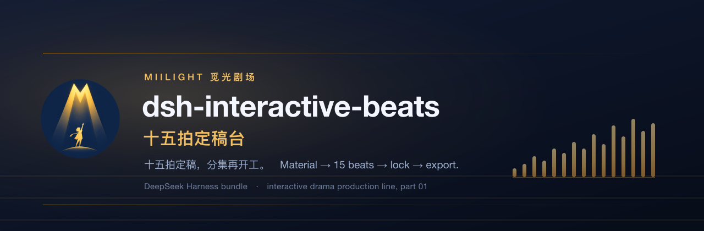
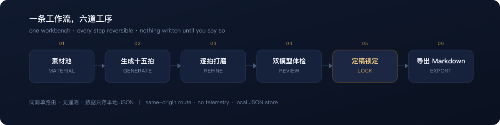

<p align="center">
  
</p>

<p align="center">
  <a href="https://github.com/MiiLight0/dsh-interactive-beats/releases"></a>
  <a href="https://github.com/deepseek-ai/deepseek-harness"></a>
  <a href="./LICENSE"></a>
  
  <a href="./README.md"></a>
</p>

# 十五拍定稿台 · dsh-interactive-beats

**把一个项目的零散素材，垒成一份能锁死的十五拍地基——后面每一集都照着它写。**

互动剧最容易崩在哪儿？不是写不出来。是写到第三十集，剧组里每个人对"这故事到底讲什么"
都有各自的版本，分支早就铺得比当初的设定更远。

这个插件是我们自己制作流程里最先被同事抢走的那一段——既然天天在用，就开源了。

**它是工作台，不是自动驾驶。** 模型出初稿，人做取舍。模型的每一次改写都先给你看逐格比对
再落盘；每一拍有自己的版本历史；定稿之后可以锁死，让写分集的人不再回头改地基。

<p align="center">
  
</p>

---

## 为什么还要一个"节拍表"

互动剧的工作量是乘出来的。一条分支变八条，八条都要有结局，结局还得回收四十集前埋的扣。
先塌的从来不是文笔，是**地基**：谁都想得起大概，没人说得准细节。

我们想要、但在一个工具里凑不齐的三件事：

1. **一个允许乱的收件箱。** 世界观、人物、梗概、群里冒出来的半句灵感——全丢进一篇文档，
   不整理，故意的。
2. **一个被允许删的模型。** 大部分结构提示词都在努力保住你粘进去的每一条。
   这一个被明确要求合并、前移、删掉，最后出来 15 拍，而不是 15 段摘要。
3. **一份明天还信得过的结构。** 逐拍版本、逐格比对、能锁、能导出一份人类编剧读得下去的
   Markdown。

## 它做什么

| 环节 | 你会拿到什么 |
| --- | --- |
| **素材池** | 一个项目一篇工作文档：世界观、人物、梗概、碎片灵感。故意不整理。 |
| **生成十五拍** | 从整堆素材里理出一条主线：一句话故事、主题、15 拍、素材缺口、结构笔记。 |
| **逐拍打磨** | 列表 / 表格双视图。表格里页码、一句话、内容、钩子直接改，失焦即存。 |
| **批量改写** | 最多选 6 拍，写一句指令，先看提案，再逐格收或一次全收。 |
| **体检** | 一个总分、五个加权维度、具体问题、一条改法、三个备选。双模型模式把同一道题跑两遍，两张报告并排。 |
| **锁定** | 先定稿，再锁定。锁住的拍只读。15 拍全锁，地基就冻住了。 |
| **导出** | Markdown：brief、15 拍、体检意见、笔记、素材缺口、结构笔记，一并带走。可复制可下载。 |

版本号是 `MMDDHHMM`（月日时分），不是 V1/V2；同一分钟里存两次会自动往后挪一分钟，
保证两个版本永远分得开。星标一个版本 = 标记"这个能回滚"，历史可以只看星标。

## 环境要求

- DeepSeek Harness **0.2.x**（`engines.dsh` 是 `>=0.2.0 <0.3.0`）。
- 一个 **web** profile。面板是客户端模块（`dsh.client.platform: "web"`）；TUI 和 headless
  profile 只拿到 HTTP 那一半。
- Node.js **20+**。
- DSH 里至少有一个可用模型——面板直接读 Host 的模型列表，DSH 已经配好的模型不需要再填 Key。

## 安装

挑一条就行；命令都指向 profile，`web` 是最常用的那个。

```sh
# 走 GitHub，跟默认分支
dsh plugin --profile web add github:MiiLight0/dsh-interactive-beats

# 走 GitHub，钉住某个 release（真要用的话推荐这条）
dsh plugin --profile web add github:MiiLight0/dsh-interactive-beats#v0.1.0

# 走 tarball，不碰 registry，也不需要构建授权
dsh plugin --profile web add ./dsh-interactive-beats-0.1.0.tgz

# 走 npm（发布之后）
dsh plugin --profile web add dsh-interactive-beats
```

这包是纯 JavaScript，没有构建步骤，所以上面几条都不需要去 pnpm 里批准 `allowBuilds`。

装完三步：

1. 重启 profile，让 Host 那一半加载。
2. 刷新一次 Harness 页面——客户端那一半是随页面加载的。
3. 左侧边栏（`sidebar.panellist`）和主面板里出现 **十五拍定稿台**。

确认它真的成了一层 profile，而不只是个普通依赖：

```sh
dsh --profile web --dump-config | grep interactive-beats
```

PowerShell 里没有 `grep`，换成 `| Select-String interactive-beats`。

装对了会出现 `interactive-beats` 这一行，指向 `dsh-interactive-beats`。如果包装上了却没这行，
profile 会打印 `declares no dsh.bundle — installed as a plain dependency, not a profile layer`。

卸载：

```sh
dsh plugin --profile web remove dsh-interactive-beats
```

项目数据留在 profile 的 `plugin-data` 目录里（见 [数据与隐私](#数据与隐私)），想要干净重来就手动删掉。

## 上手怎么用

1. **新建项目**——起个名字。包里不带示例故事，从空白开始。
2. **素材池**——有什么粘什么。越乱越好，生成提示词本来就按"砍、并、挪"写的，不负责保全。
3. **生成 15 拍**——普通模型 30–90 秒。结果会覆盖全部 15 拍，所以只要有一拍已经有字，面板会先问一遍。
4. **对比生成**——可选。同样的素材、同样的提示词，主副两条线路并行跑，出两份完整表。
   不点"采用这一版"就什么都不写。
5. **十五拍**——列表 / 表格随便切，哪拍觉得不对就"体检这一拍"。
6. **批量改写**——选拍、写一句指令、看红绿比对，再逐格收。
7. **定稿 → 锁定**——信得过的先锁。锁住的拍拒绝修改；只要还有拍锁着，生成会直接停下，先全解锁。
8. **导出**——Markdown，直接给编剧，或者喂给你自己的分集工具。

## 模型怎么接

设置面板会问 Host 有哪些模型（`llm.listProviders()` / `llm.listModels()`），按 provider 分组。
三种线路：

| 线路 | 用在哪 | Key |
| --- | --- | --- |
| **DSH 默认** | 跟随 Host 当前默认模型 | 不需要 |
| **指定 DSH 模型** | 生成、单次体检、双模型体检的任意一边 | 不需要 |
| **外部接口** | 任何 OpenAI Chat Completions 兼容地址 | 存在 DSH 凭据服务里 |

双模型体检要两个**不同**线路才有意义：两个 DSH 模型，或者一个 DSH 模型 + 一个外部接口，
两张报告卡会并排摆出来。

**关于外部接口。** 全新安装时地址是空的，你不填它就永远不会被调用——默认状态下没有任何内容
会外发。只接受 `http` / `https` 地址。一旦你填了，被问的那几拍原文就会发到那个地址去，
所以指向你信得过的服务：

- OpenAI Chat Completions 兼容：`https://<host>/v1/chat/completions`
- 你自己 provider 前面的本地网关
- 已经持有公司凭据的代理

Key 写进 Host 凭据服务，键名 `interactive-beats:external-model-key`；不会进项目 JSON，
不会回传给浏览器，面板只告诉你"有没有存"。

## 配置

这个组合包只贡献一行 patch，而且没有选项：

```yaml
# cordis.patch.yml
- insert:
    - id: interactive-beats
      name: dsh-interactive-beats
```

- `id` 是稳定的 Cordis 条目 id。想禁用或调整顺序，在你自己的 profile `cordis.patch.yml` 里覆盖这一行。
- `name` 必须等于包名，否则 Loader 找不到它。

故意没有 `Config` schema：模型、体检模式、外部接口都是"每个用户自己的事"，属于面板，
不属于 profile 文件。其余状态（项目列表、素材、拍、版本）都在插件自己的 JSON 里。

## 数据与隐私

- **存在哪**：`$DSH_HOME/profiles/<profile>/plugin-data/interactive-beats.json`——目录取自
  `ctx.profileContext.dir`，所以两个 profile 是两份独立的库；不经 dsh 启动时才退回
  `~/.dsh/plugin-data/interactive-beats.json`。
- **怎么写**：原子写（临时文件 + rename），权限 `0600`，只有你自己读得到。
- **写什么**：项目名、素材、brief、15 拍、每拍版本（每拍最多 30 个）、体检记录、设置。
  每个 profile 最多 20 个项目。
- **联网**：没有遥测、没有统计、没有更新检查、启动时不发任何请求。唯一的出网是你手动触发的模型调用：
  - DSH 模型线路走 Host 自己的 LLM 服务，用你在那儿配的 provider。
  - 外部线路只打你填的那个地址，而且只在你填了之后。
- **浏览器**：面板只通过一条同源路由跟 Host 说话。带其他 `Origin` 的请求直接 `403`，
  别的网页没法在你开着 Harness 的时候动你的库。
- **Key**：不进项目 JSON、不进响应体、不进导出。
- **导出**：Markdown 在本地生成，插件不上传任何地方。

在面板里删项目，就是从那一个文件里删掉它的素材、拍和版本。没有云副本需要收拾。

## HTTP API

客户端只用一条同源路由：`GET/POST /interactive-beats/api`。想在面板外做批量操作或者查状态时很有用。

| Action | Body | 返回 |
| --- | --- | --- |
| `createProject` | `title` | `{ state }` |
| `selectProject` | `id` | `{ state }` |
| `renameProject` | `id`, `title` | `{ state }` |
| `deleteProject` | `id` | `{ state }` |
| `saveMaterial` | `id`, `material`, `brief` | `{ state }` |
| `saveBeat` | `id`, `key`, `patch` | `{ state }` |
| `lockBeat` | `id`, `key`, `locked` | `{ state }` |
| `lockAll` | `id`, `locked` | `{ state }` |
| `generateBeats` | `id`, `material`, `brief` | `{ state, generation }` |
| `compareBeats` | `id`, `material`, `brief` | `{ candidates, warnings }` |
| `applyBeatsCandidate` | `id`, `candidateId` | `{ state, generation }` |
| `reviewBeat` | `id`, `key`, `mode` | `{ state, review, warnings }` |
| `reviewSheet` | `id`, `mode` | `{ state, review, warnings }` |
| `batchUpdate` | `id`, `keys`, `instruction`, `op`, `target`, `model` | `{ proposals, note, model, op, target, keys }` |
| `batchApply` | `id`, `proposals`, `note` | `{ state }` |
| `getVersions` | `id`, `key` | `{ versions, current }` |
| `starVersion` | `id`, `key`, `versionId`, `starred` | `{ versions, state }` |
| `restoreVersion` | `id`, `key`, `versionId` | `{ state }` |
| `listModels` | — | `{ providers, current, supported }` |
| `saveSettings` | 模型设置，可选 `apiKey` | `{ state }` |
| `testModel` | 草稿模型设置，可选 `apiKey` | `{ ok, label, reply }` |
| `pingVersion` | — | `{ pong }`——报出确切版本，例如 `dsh-interactive-beats@0.1.0` |

`GET` 只返回 `{ state }`。state 里已经剥掉了版本快照，只留 `versionCount` /
`latestVersionAt` / `starredCount`；要看列表本身请调 `getVersions`。

## Model Experience（模型视角）

这个组合包**不注册任何面向模型的工具**。它不往工具列表里加东西，也不改 agent 行为 ——
装了和没装，模型看到的工具面完全一样。没有 tool schema、没有 `run_in_background` 约定、
没有输出渲染器要交代。

模型在这里当然也干活，但只在人按下按钮的时候：

- `generateBeats` 把素材池发过去，回来一个 JSON：
  `{ logline, theme, format, beats: [{ key, oneLine, content, turn, hook, source, notes, episodeHint }], missing, structureNotes }`。
- `batchUpdate` 发最多 6 拍 + 一句指令，回来逐字段提案；先给你看比对结果，`batchApply` 才写。
- `reviewBeat` / `reviewSheet` 返回
  `{ total, dimensions: { function, causality, character, theme, hook }, issues, fix, alternatives }`，
  `total` 是五个 1–10 维度的加权和。

提示词在 Host 那一半（`index.js`）里，不在客户端——浏览器改不了它。十五拍里有六拍是区间拍
（给页码区间而不是单页），生成提示词里每一拍都写明了。

如果你在找一个"让模型多长几只手"的工具插件，这个不是；它是给做结构的那个人用的。

## 已知限制

- **评分是模型自评。** 用来比较同一拍的两个版本、或者看两个模型在哪儿打架，很好用；
  但它不是客观质量分，跨模型、跨温度都不可比。
- **十五拍是结构草稿。** 固定任务和三句教练问题一直摆在面板上，就是为了让人能推翻模型。
  请当第一稿看。
- **页码锚点是电影剧本锚点。** 默认模板按 110 页的节拍表来。72 集短剧请把它当比例尺
  （大约 1.5 页 / 集），不是字面页数。区间拍会显示自己的经典区间，偏移量算到最近的区间边缘。
- **面板中文优先。** 界面文案是中文；市场元数据（`locale/zh.json`、`locale/en.json`）和这份
  README 都有英文，少数主操作带了英文串，但整个面板还没做完英文化。
- **一台机器一个文件。** 每个 profile 一个 JSON，没有同步、没有合并、没有多人。两个 Harness
  实例共用一个 profile 目录会互相覆盖。
- **硬上限。** 20 个项目、每拍 30 个版本、一次批量 6 拍、素材 12 万字、请求体 2 MB。
  撞到上限会明确报错，不会偷偷截断。
- **不流式、不能取消。** 生成或体检会一直等到模型答完，请求 240 秒超时。素材很长 + 模型很慢
  有可能撞到这条线。
- **外部线路只吃文本。** 说的是 OpenAI Chat Completions，不带工具、不流式、不看图。
  不合规的端点会给出可读的报错。
- **还没有 schema 迁移。** 存储停在 `STATE_VERSION = 1`；将来真要破坏性改动，得补一个迁移步骤，
  现在没有。
- **面板只在 web profile。** TUI 和 headless 还是能打 HTTP 路由，但没有终端界面。

## 做它的人，自己也在用

<p align="center">
  <br>
  <sub>MiiLight 觅光剧场 · 短剧与互动剧，自己写，自己拍</sub>
</p>

我们是个小团队：拍短剧的编剧导演，焊上两个写代码的。这套流程不是演示用的样品，
是我们每天开工的东西——先在自己的项目里跑顺，才敢拿出来。

Harness 内测第一天我们就在；之前写的 Obsidian 插件，也被联创翻过牌子——做插件是我们的老手艺，
不是临时起意。

这是**计划中约 10 款系列插件的第一弹**。每款管互动剧生产线的一段，全部开源。第一款故意挑了
最不性感、但最吃重的那一段。

已经排上队的是这几款：

| # | 包名 | 管什么 | 状态 |
| --- | --- | --- | --- |
| 01 | `dsh-interactive-beats` | 十五拍定稿台——结构地基 | **已上架 · 0.1.0** |
| 02 | `dsh-interactive-branch` | 分支地图——选项节点与分支图 | 开发中 |
| 03 | `dsh-interactive-outline` | 分集大纲——拆集 | 开发中 |
| 04 | `dsh-interactive-bible` | 设定集——世界观与人物 | 计划中 |
| 05 | `dsh-interactive-qa` | 分支体检——死路、够不着的结局 | 计划中 |
| 06 | `dsh-interactive-shotlist` | 分镜表——镜头清单 | 计划中 |

名字和边界还会动，序号不会。剧透一下 🍿 后面几款排队上架，长期更新，绝不弃坑 🫡

## 这个仓库怎么维护

**代码开源，更新我们自己做。**

源码是 MIT：读、fork、拆走你要的那一段，都行——放出来就是为了这个。但**我们不合并外部 PR**。
issue 和 PR 我们都会看；合适的排进计划，由我们自己动手实现，在 `CHANGELOG` 里给提出的人署名。

原因很实在：这条生产线跟着剧组的排期走，插件没法挂在别人的 review 队列后面等。一个团队、
一个口径，改完就发。外部 PR 可能被直接关掉，哪怕里面的想法我们采用了——这是流程，不是对你
那版代码的评价。

踩到 bug、或者在真实项目里用出问题，特别欢迎开 issue，那比一句“支持一下”有用得多。细节看
[CONTRIBUTING.zh-CN.md](https://github.com/MiiLight0/dsh-interactive-beats/blob/main/CONTRIBUTING.zh-CN.md)。

## 开发

```sh
npm test        # 两半都挂到桩上下文上，然后把路由跑一遍
npm run check   # 发布闸门：manifest、身份、语法、隐私
```

`npm test` 不需要 Harness 运行时、不需要依赖。它导入 Host 入口，挂到桩 Cordis 上下文，
然后打路由：`createProject` → `200`、跨源 → `403`、未知 action → `400`、`PUT` → `405`。
它还会按页面的方式加载 `client.js`，断言模块 id 等于包名、两个插槽都注册上了。

`scripts/check.mjs` 是发布闸门，零依赖：

- 按组合包契约校验 `package.json`（`dsh.bundle.patch` 存在、`dsh.bundle.platforms` 合法、
  `dsh.client.platform` 是 `web`、`engines.dsh` 存在）；
- 五处身份交叉核对——包名、patch 行、客户端模块 id、入口里的 `PLUGIN_VERSION`、
  以及安装命令里用的仓库 owner；
- 检查两份 README 是否还带着发布指南要求的段落；
- 对每个随包发布的 JavaScript 文件做语法检查；
- 扫一遍发布树里的密钥、绝对家目录路径、回环地址和内部代号。

发布前先在真 Harness 里试装本地目录：

```sh
dsh plugin --profile test add "$PWD"
dsh --profile test --dump-config | grep interactive-beats
```

## FAQ

**要自己填 API Key 吗？** DSH 里已经配好模型就不用。面板列的是 Host 知道的模型。外部线路是
可选加装，默认空着。

**它能替我写分集吗？** 不能。它出结构，外加对结构的体检。导出的 Markdown 是给编剧、或者
给你自己的分集工具用的。

**为什么是 15 拍？** 因为一套共同的结构词汇胜过一张白纸，而 15 这个数量刚好能装在脑子里。
表格可改，拍名是通用的编剧术语，跟《Save the Cat!》的权利方没有任何关系。

**Windows 能用吗？** 能。`dsh.bundle.platforms` 覆盖 macOS / Linux / Windows，路径全走
`node:path`，没有任何 shell 调用。

**两个人能共用一个项目吗？** 还不能。一个 profile、一个 JSON、没有合并。这是第二版第一件要解决的事。

## 许可

MIT——见 [LICENSE](./LICENSE)。Copyright (c) 2026 MiiLight 觅光剧场。

这是一个独立的社区组合包，与 DeepSeek、Blake Snyder Enterprises 及《Save the Cat!》作者
没有关联、未获其背书或赞助；十五拍是一种描述性使用的结构惯例，拍名是通用编剧术语。

MiiLight 的名称与 `docs/` 里的标志是团队的商标。MIT 许可覆盖源代码，不包含这些品牌素材的使用权。
